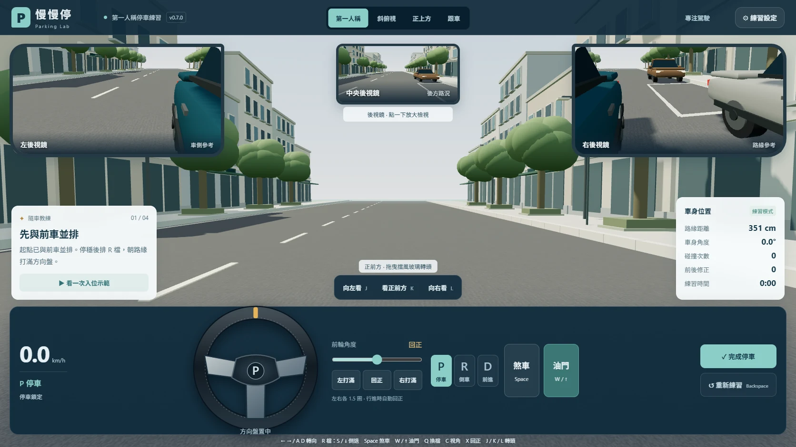
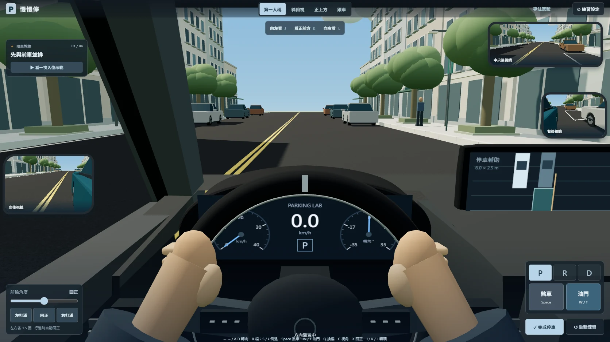
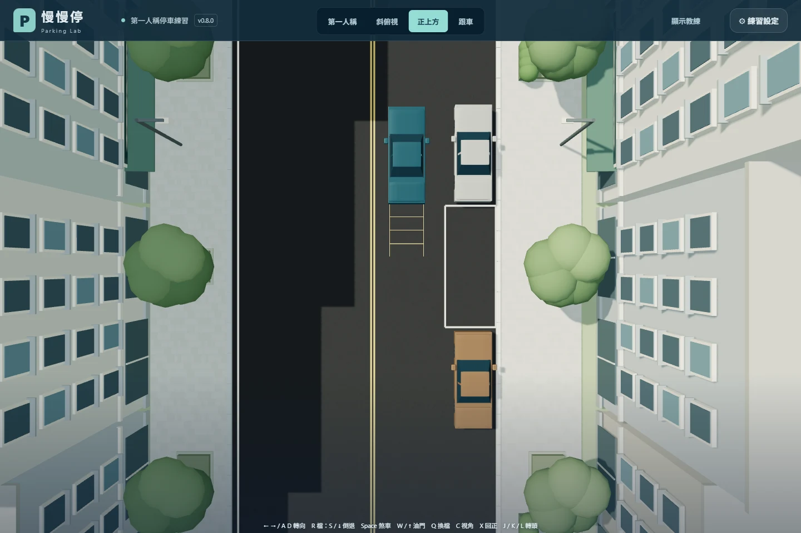
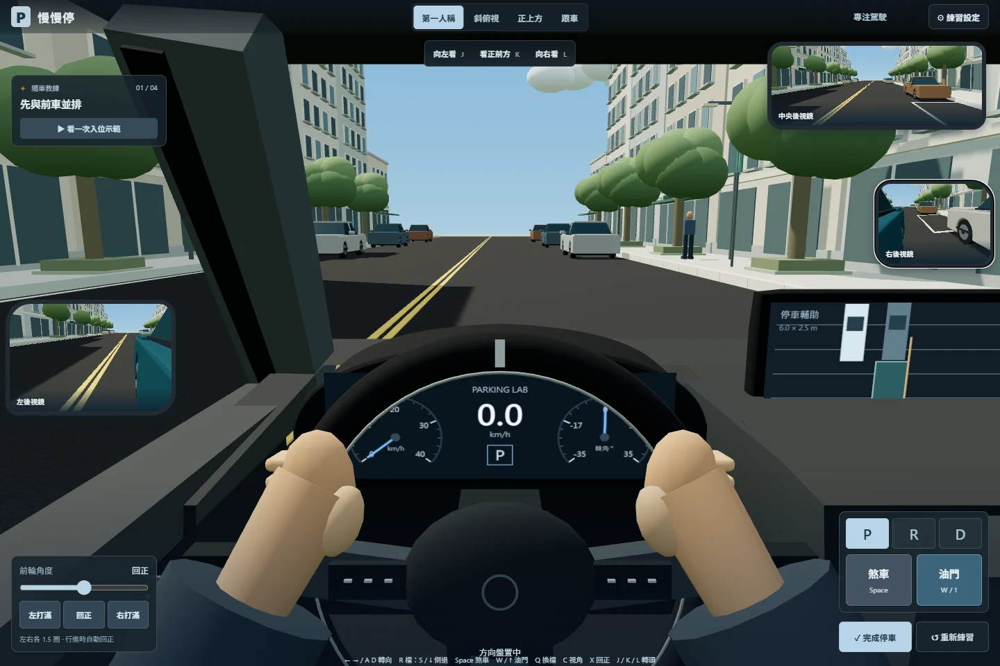
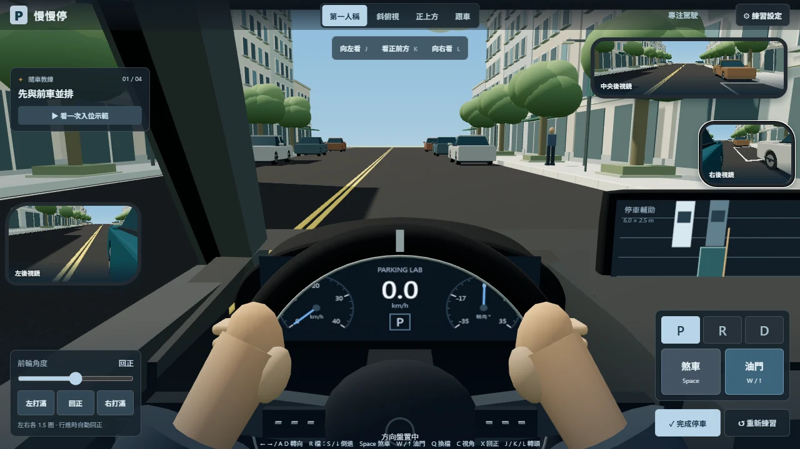
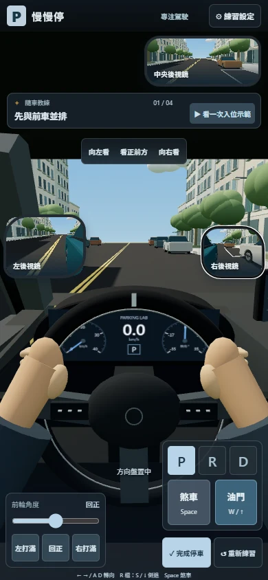
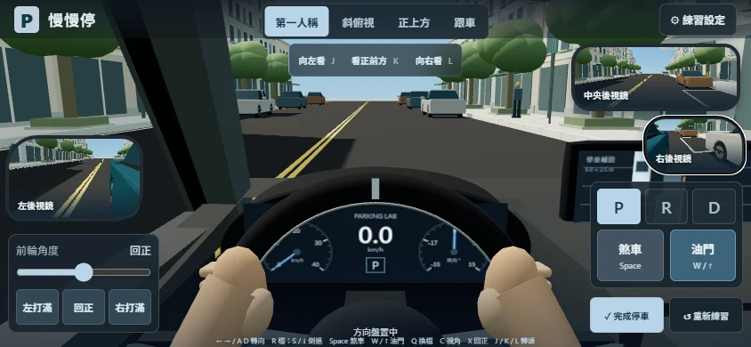

# v0.8 車內畫面與比例驗收

本輪目標是對齊參考圖的第一人稱構圖：左側 A 柱與門板、前方街景、前景大方向盤與雙手、後方儀表、右側中控螢幕及較小的鏡框。參考圖用於構圖比較；沒有以主觀百分比宣稱寫實程度。模型仍是低多邊形風格，材質、手部與原廠內裝細節尚有差距。

## 畫面

| v0.7 原版 | v0.8 車內模型 |
| --- | --- |
|  |  |

第一人稱的方向盤、儀表、門板和 A 柱都是 3D 幾何。原本 SVG 方向盤在此視角隱藏，保留透明拖曳區並依 3D 輪圈投影定位。向旁邊看時，離開視野的方向盤不再攔截擋風玻璃拖曳。回正後拖曳區會恢復。

儀表顯示實際車速、P/R/D 及前輪角度，不以虛構轉速表代替動力資料。中控畫面顯示目前車格、障礙車和玩家車位置。雙手採簡化握持動畫，尚未實作真實換手。

## 公尺尺度

| 項目 | 設定 | 驗證／限制 |
| --- | --- | --- |
| 車身長 × 寬 | 4.63 × 1.78 m | body-envelope 實際 bounding box；寬度不含後視鏡 |
| 車高 | 1.435 m | 整車 bounding box，自路面至車頂 |
| 軸距 | 2.70 m | 3D 輪軸中心距與物理模型一致 |
| 輪距 | 1.53 m | 沿用 v0.7 模型假設 |
| 輪胎半徑 | 0.317 m | 輪心高度同為 0.317 m，最低點為路面 |
| 標準車格長 × 寬 | 6.00 × 2.50 m | 物理判定與 3D 標線共用資料；標線寬 0.10 m |
| 駕駛眼高 | 1.16 m | 通用轎車座姿假設，非原廠座艙測量 |
| 駕駛橫向位置 | 車體中心向左 0.40 m | 左駕，仍在車殼內 |
| 基礎俯角 | 向下 10° | 65°、80°、95° 鏡頭使用同一眼位 |

外部尺寸來源及車格適用範圍見 [v0.7 尺度紀錄](physics-v07.md)。並非所有真實車輛和路邊格都使用上述尺寸，也未將示意外觀宣稱為原廠 Altis 模型。

舊版整車以非等比例縮放校正尺寸，實際最低點距地約 17.7 mm、可見高度約 1.4173 m，且輪胎上半部被完整車殼遮住。本版以公尺直接建立車身，量測最低點約為 0 m、可見高度 1.435 m；輪軸旁 y=0.40 m 的側向射線穿過輪拱，y=0.80 m 仍命中上方葉子板。這些檢查避免只更新尺寸常數，卻未修正可見車模。

## 不同畫面尺寸

| 桌機 1440 × 960 | 筆電 1280 × 720 |
| --- | --- |
|  |  |

| 手機 390 × 844 | 手機橫向 844 × 390 |
| --- | --- |
|  |  |

另留存 [1024 × 768](v08-review/driver-1024x768.webp)、[360 × 740](v08-review/driver-360x740.webp)、[向左看](v08-review/look-left.webp)、[後照鏡放大](v08-review/mirror-expanded.webp)、[外觀](v08-review/exterior.webp)。鏡面為即時 3D 視角，以 HUD 鏡框合成，並非完整反射材質的實體後視鏡。

## 驗證

- Node：25 項通過，包括建置模組雜湊、物理與示範回歸。
- Chromium：33 項通過，使用實際雜湊建置檔，含新增的車模尺度、輪拱及鏡頭高度檢查。
- 六種視窗尺寸檢查：1440×960、1280×720、1024×768、390×844、360×740、844×390；檔位、踏板及完成／重來按鈕至少 40 px，點擊中心未被其他元素遮擋。
- 實際驗證方向盤拖曳、漸進回正、放大鏡面、轉頭、油門／煞車、換檔、四種鏡頭、設定保存與完整停車示範。
- 桌機、手機截圖檢查無 JavaScript pageerror；實際 GPU 效能仍取決於裝置。

physics.js、steering.js、training.js 與 game.js 的動力、輸入及評分邏輯沿用 v0.7。本輪未調整加速曲線或控制手感。
