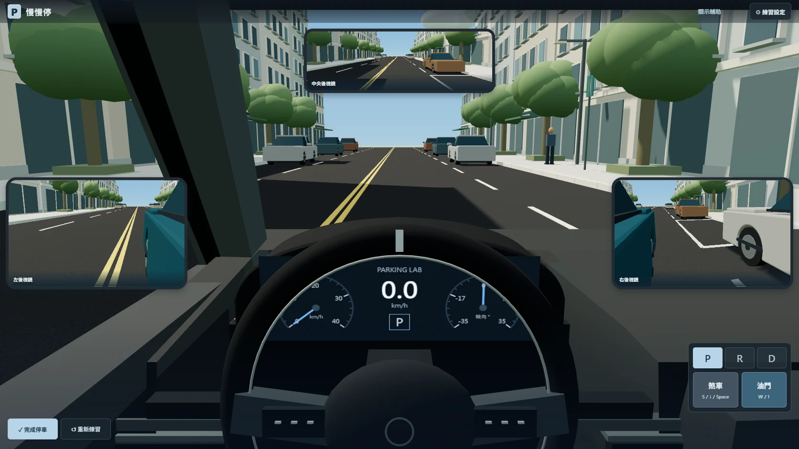
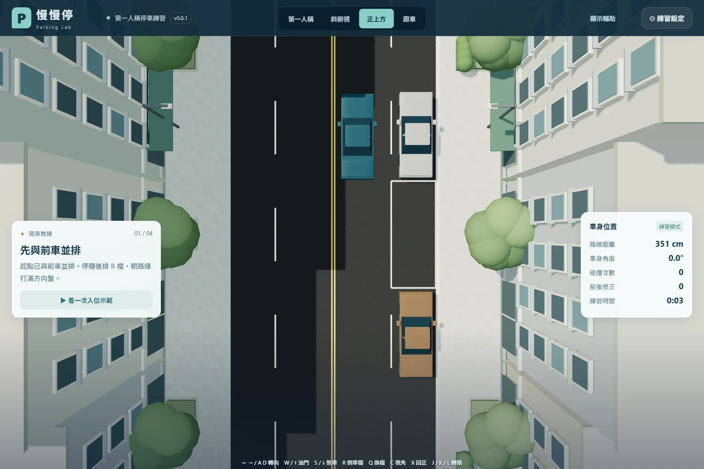
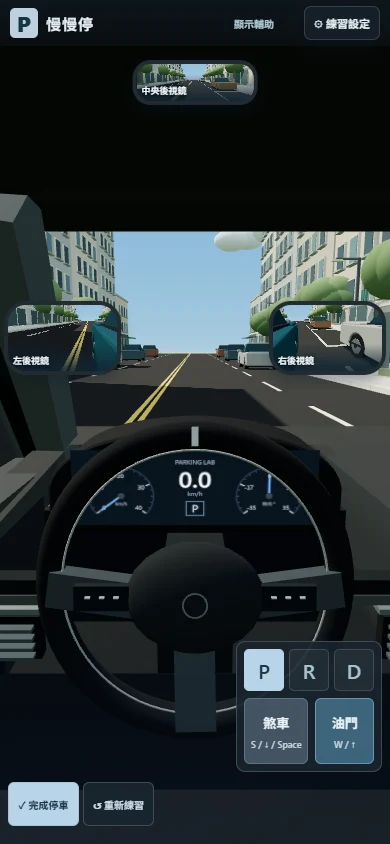
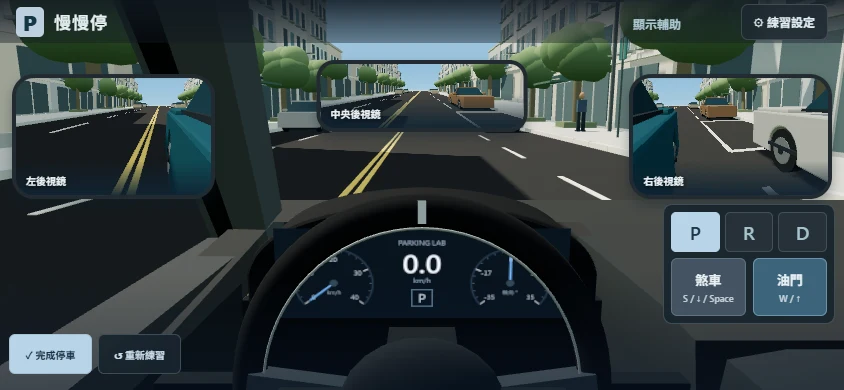

# v0.8.1 操作與視野修正

依使用者附圖調整：左右鏡放大且水平對齊、中央鏡移到上方中央；移除打叉的停車圖與圈起的雙手，保留方向盤及實際儀表。預設收起教練、方向盤滑桿、視角列、轉頭按鈕、快捷提示與預測軌跡；需要時可按「顯示輔助」。

## 現行操作

| 輸入 | 行為 |
| --- | --- |
| W／↑／油門踏板 | 依 D 或 R 檔加速；P 檔不移動 |
| S／↓／Space／煞車踏板 | 所有檔位均煞車；同時踩油門時煞車優先 |
| R | 選倒車檔，之後仍使用 W／↑ 油門 |
| A／D／←／→／拖曳方向盤 | 操舵；放開後漸進回正 |
| 滑鼠拖曳擋風玻璃、按住 J／L | 轉頭；放開後平順回到前方 |
| K | 平順回到前方 |

方向盤回正不再以車速或角度門檻啟動。左右正負 0.005、0.2、1.0 的轉角均驗證放開即開始，由慢到快回中；手指持續拖住輪圈或滑桿時不回正。此為使用者要求的操作輔助，包含車輛靜止時。

轉頭使用解析阻尼回到目標；放開按鍵或滑鼠後目標為前方，保留連續角度與速度，不直接切換鏡頭。30／60／120 Hz 的回正結果一致。

## 未踩油門的蠕行

保留 D／R 換檔後放開煞車的低速蠕行，但降低目標速度並限制起步加速度及 jerk。不是自動踩油門。

| 項目 | v0.7／v0.8 | v0.8.1 |
| --- | --- | --- |
| D 無油門目標 | 3.96 km/h | 2.34 km/h |
| R 無油門目標 | 3.06 km/h | 1.80 km/h |
| 蠕行最大起步加速度 | 0.65 m/s² | 0.28 m/s² |
| 蠕行起步 jerk | 8 m/s³ | 0.45 m/s³ |

測試同時檢查半秒速度低於 0.25 km/h、一秒低於 0.8 km/h、持續踩煞車能停在零速，以及鬆開油門不再延續正加速度衝刺。

## 道路及鏡面尺度

ROAD 資料供場景與物理邊界共用，車體仍為 4.63 × 1.78 × 1.435 m、軸距 2.70 m。

| 項目 | 尺度／位置 |
| --- | --- |
| 每向行車道 | 3.25 m，各一車道 |
| 兩側停車帶 | 每側 2.50 m |
| 總路面寬 | 11.50 m |
| 右側路緣 x | +5.00 m |
| 左側路緣 x | −6.50 m |
| 雙黃線中心 x | −0.75 m |
| 標準車格 | 6.00 × 2.50 m |
| 路緣高度 | 0.15 m |

選用的是一種具體市區街道斷面，並非所有現實道路都相同。車道寬度參照[內政部《市區道路及附屬工程設計標準》第 11 條](https://law.moj.gov.tw/LawClass/LawAll.aspx?pcode=D0070156)：主要及次要道路汽車道至少 3 m；本場景採 3.25 m。停車帶不侵入行車道。左右停車場景鏡射同一套數值。

1440 × 960 視窗下，左右鏡框均為 360 × 222.9 px，垂直中心同為 y=499.2 px；中央鏡框 400 × 135.2 px。側鏡畫面比例 1.65、中央鏡 3.15，攝影機依實際畫面比例更新投影。這是便於練習的 HUD 配置，不是實車後視鏡外殼尺寸。

## 畫面檢查

| 手機直向 | 手機橫向 |
| --- | --- |
|  |  |

另存 [1440×960](v081-review/driver-1440x960.webp)、[1280×720](v081-review/driver-1280x720.webp)、[1024×768](v081-review/driver-1024x768.webp)、[360×740](v081-review/driver-360x740.webp)、[放大右鏡](v081-review/mirror-expanded.webp)、[按住向左看](v081-review/look-left-held.webp)。

## 驗證

- Node：28 項通過，涵蓋踏板固定語意、平順蠕行、各角度回正、視線回正、車模及停車示範。
- Chromium：37 項通過，包含新預設精簡畫面、鏡面尺寸及對齊、滑鼠／鍵盤釋放回頭、實際道路寬與碰撞邊界。
- 六種視窗尺寸的主要控制元件可操作，另以實際截圖修正橫向手機鏡面與檔位面板的遮擋。
- 設定視窗、畫面提示與 README 的現行操作均使用 W／↑ 油門、S／↓／Space 煞車。

離線版本以 `npm run build:offline` 產生單一 HTML，另以 file:// 直接開啟驗證油門、煞車、後照鏡及轉頭，確認沒有外部 HTTP 請求。
