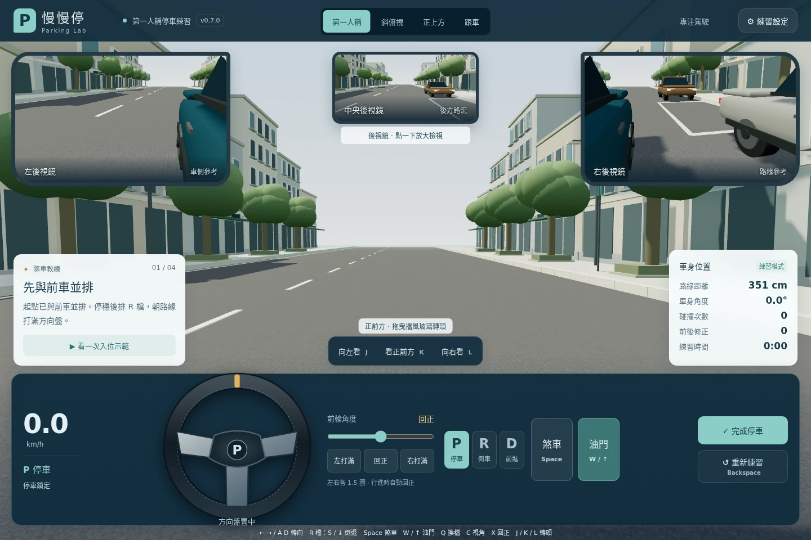

# v0.7.0 低速自排模型

本次目標：平順且可預測的加速、放煞車蠕行、速度相關方向盤回正，以及車身／車格／碰撞一致的公尺尺度。

## 尺度與來源

| 項目 | 本次設定 | 依據／限制 |
| --- | --- | --- |
| 車身長／寬／高 | 4.63 / 1.78 / 1.435 m | [Toyota Taiwan Altis 官方規格](https://www.toyota.com.tw/showroom/ALTIS/fullsepc.aspx)，2026-10-19 查閱；並非所有年式皆同尺寸 |
| 軸距 | 2.70 m | 同上；後軸與車身中心距離 1.35 m，前後懸對稱是模型近似 |
| 輪距 | 1.53 m | 模型設定，並非本次台灣車型的量測結果 |
| 標準車格 | 6 × 2.5 m | 採[監理服務網路邊劃設原則](https://www.mvdis.gov.tw/webMvdisLaw/Download.aspx?ID=1474&type=Law)小型車 5–6 × 2–2.5 m 範圍上緣；各地實際格位不盡相同 |
| 寬鬆／挑戰 | 7 × 2.5 / 5.5 × 2.2 m | 寬鬆為刻意加長的教學場景；挑戰採較小格位 |
| 標線寬度 | 0.10 m | 公尺尺度，格位數值以標線中心距表示；SAT 車身框不包含伸出的側鏡 |

`physics.js` 的 `CAR`／`BAYS` 是物理、3D 車殼、軸距、車格線及評分的共用尺寸。3D 仍是示意房車外型，並非原廠 Altis 外觀掃描。

## 動力行為

- 固定 120 Hz 模擬，位置以步內平均速度積分，圓弧採後軸 bicycle model 解析式。
- 油門支援 0–1 輸入；目前按鈕／鍵盤為 0 或 1。起步以 2.5 m/s³ 的加速度變化上限接入，穩定油門後保持線性加速。
- 一般模式前進加速度 1.8 m/s²、倒車 1.2 m/s²；鬆油門較快移除驅動力，再以簡化速度相關阻力滑行。此為可玩性校準值，並非實車加速曲線。
- 前進／倒車速度上限 30 / 12 km/h，屬停車場練習的速度限制；低速模式 2.88 km/h。
- D／R 放煞車後蠕行目標 1.10 / 0.85 m/s（3.96 / 3.06 km/h）；精細模式蠕行 0.55 m/s（1.98 km/h）。鬆油門不會自動停車。
- 煞車優先，減速度 6 m/s²、踩住可停住。切檔前需煞停；切檔不會鎖住煞車，放開立即開始蠕行。
- 沿用 P 鎖定、碰撞煞停、按鍵失焦釋放、背景分頁暫停。重新取得焦點後，D／R 若未煞車會恢復蠕行。

一般模式全油門純模型結果（無障礙物，非道路實測）：

| 經過時間 | D | R |
| --- | --- | --- |
| 1 s | 4.17 km/h | 3.30 km/h |
| 2 s | 10.65 km/h | 7.62 km/h |
| 3 s | 17.13 km/h | 11.94 km/h |
| 5 s | 30.00 km/h | 12.00 km/h |

## 方向盤與輪胎

- 左右各 540°、全行程 3 圈，等效中心前輪最大 35°，約 15.43:1。圈數與轉向比為通用房車設定，未宣稱為特定年式 Altis 原廠 rack 數值。
- 鍵盤、打滿按鈕、X 回正以 450°/s 移動；全行程需 2.4 秒。輪圈拖曳保留跨過 ±180° 接縫的連續圈數。
- 以速度相關的臨界阻尼回正輔助近似手感，解析積分避免不同幀率震盪。靜止不回正；倒車輔助較弱；拖住輪圈／滑桿時保持輸入。這是主動輔助近似，未解輪胎 caster／trail 的力矩。
- 3D 左右前輪以 Ackermann 幾何分別計算角度，內輪轉角較大；車身軌跡使用等效中心輪角。
- 預測軌跡表示「保持目前輪角倒車」的結果。
- 示範使用同一動力模型及有限轉向速度，逐步產生可碰撞檢查的軌跡，不瞬移車輛或方向盤。

## 介面檢查

沿用深藍駕駛台 `#102b3c`、青綠選取 `#8bcec7`、琥珀倒車提示 `#efc67d` 與既有中文字型。以方向盤為操作主體；側鏡預設縮小，點擊時保留大型觀察面積。

| 尺寸 | 檢查項目 |
| --- | --- |
| 1440 × 960 | 280 px 方向盤、約 389 × 239 px 側鏡、控制區與教練分離 |
| 1280 × 720 / 1024 × 768 | 短螢幕控制台、鏡面不蓋住控制 |
| 390 × 844 / 360 × 740 | 170 / 154 px 方向盤、踏板與換檔完整可按 |
| 844 × 390 | 146 px 方向盤、鏡面／轉頭／控制台分開 |

驗證：`npm test` 25 項通過；正式 hash build 的 Chromium E2E 31 項通過（本機離線路由，尚未推送至 GitHub Actions）。最後的版面微調與換檔測試穩定化另跑 7 項相關 E2E 複查。

回歸過程先以新測試重現 1280 × 720 的右鏡／數據卡重疊，以及放大鏡面被中央鏡框遮擋，再修正並確認通過。高負載時全油門可能在點擊送達前抵達場地邊界，因此換檔保護測試改為先鬆油門、以穩定蠕行驗證；車輛的停穩換檔規則保持原設計。

[筆電](v07-review/cockpit-1280x720.webp) · [平板](v07-review/cockpit-1024x768.webp) · [手機](v07-review/cockpit-390x844.webp) · [小手機](v07-review/cockpit-360x740.webp) · [手機橫向](v07-review/cockpit-844x390.webp) · [放大鏡面](v07-review/mirror-expanded.webp)

## 邊界

以低速練習為範圍，未實作輪胎滑移、側向動力學、完整引擎／CVT／扭力轉換器、坡度與懸吊。尺寸有官方依據，動力與回正需後續依實車量測校準；無法承諾與真車所有行為完全一致。
